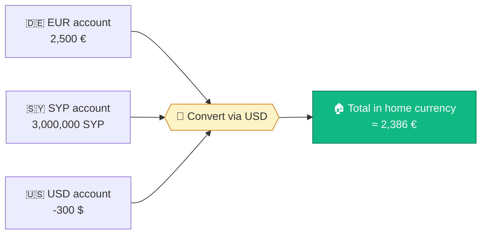

<div align="center">


# Masroufi · مصروفي

### Know where your money goes — effortlessly.

A privacy-first, offline-ready expense tracker with multi-currency accounts,
smart auto-categorization and a weekly spending report.

<br/>


<br/>

**🇸🇦 العربية &nbsp;·&nbsp; 🇬🇧 English &nbsp;·&nbsp; 🇩🇪 Deutsch &nbsp;·&nbsp; 🇹🇷 Türkçe**

[✨ Features](#-features) &nbsp;•&nbsp;
[🚀 Quick Start](#-quick-start) &nbsp;•&nbsp;
[☁️ Deploy](#️-deploy-to-vercel) &nbsp;•&nbsp;
[📱 Install](#-install-on-your-phone) &nbsp;•&nbsp;
[💱 Currencies](#-multi-currency--exchange-rates) &nbsp;•&nbsp;
[🗺️ Roadmap](#️-roadmap)

</div>

---

## 💡 Why Masroufi?

Most expense apps fail because logging is tedious. **Masroufi** removes the friction:

> 🟢 **Log an expense in 3 taps** &nbsp;·&nbsp; 🔵 **See one clear number: "Safe to spend today"** &nbsp;·&nbsp; 🟡 **Get a weekly report with one actionable tip**

No account. No server. Your financial data **never leaves your device**.

---

## ✨ Features

<table>
<tr>
<td width="50%" valign="top">

### ⚡ Fast & Simple
- ➕ **3-tap entry** — amount → save, with 5-second **Undo**
- 🧠 **Smart categories** — learns from your corrections
- 🔎 **Search & filter** by note, category or period
- ✏️ Edit & delete any expense

</td>
<td width="50%" valign="top">

### 💰 Salary & Budget
- 📅 Custom **payday** and pay cycles
- 🎯 **Safe-to-spend today** — updates instantly
- 📉 **Month-end forecast** — *"at this pace you'll run out on…"*
- 🏠 Fixed commitments (rent, installments)

</td>
</tr>
<tr>
<td width="50%" valign="top">

### 🌍 Multi-Currency
- 🏦 **Multiple accounts**, one per currency
- 🔄 Automatic **exchange-rate conversion**
- ➖ An account may go **negative** if others cover it
- 🌐 **200 countries** with flags & currencies

</td>
<td width="50%" valign="top">

### 📊 Weekly Report
- 🍩 Spending **donut chart** by category
- 🏆 Top 3 expenses & biggest spending day
- ↕️ Change vs. last week
- 💡 **One actionable savings tip**

</td>
</tr>
<tr>
<td width="50%" valign="top">

### 🔒 Privacy First
- 🚫 **No sign-up**, no account, no tracking
- 📱 All data stored **locally** on the device
- 🙈 **Privacy mode** — blur amounts with one tap
- 💾 Backup **export / import** (JSON)

</td>
<td width="50%" valign="top">

### 🎨 Delightful UX
- 🌗 Light / Dark / Auto theme
- ↔️ Full **RTL** support for Arabic
- 🕌 **Hijri** date alongside Gregorian
- 🔔 Daily reminder & weekly report notifications

</td>
</tr>
</table>

---

## 🚀 Quick Start

> **Requirements:** any static web server — no build step, no `npm install`.

```bash
# 1. Clone
git clone https://github.com/Talal-Alhammami/Spend-Calculator-App.git
cd Spend-Calculator-App

# 2. Serve (pick one)
python -m http.server 8080
# or
npx serve .

# 3. Open
#    http://localhost:8080
```

> [!IMPORTANT]
> Don't open `index.html` by double-clicking it. The Service Worker (offline mode) requires `http://` or `https://`.

---

## ☁️ Deploy to Vercel

| Step | Action |
|:---:|---|
| **1** | Push this repository to GitHub |
| **2** | In Vercel → **Add New → Project** → import the repo |
| **3** | **Framework Preset:** `Other` |
| **4** | **Build Command:** *leave empty* · **Output Directory:** `./` |
| **5** | Click **Deploy** 🎉 |

> [!TIP]
> Every `git push` to `main` redeploys automatically. Users get the new version on their next visit — `sw.js` is configured as *network-first* and is never cached by Vercel.

---

## 📱 Install on Your Phone

<table>
<tr>
<th>🤖 Android (Chrome)</th>
<th>🍎 iPhone (Safari)</th>
</tr>
<tr>
<td>

1. Open the app URL
2. Tap **⋮** menu
3. Select **Install app**

</td>
<td>

1. Open the app URL
2. Tap **Share** ⬆️
3. Select **Add to Home Screen**

</td>
</tr>
</table>

> [!NOTE]
> On iOS, notifications only work after adding the app to the Home Screen (iOS 16.4+).

---

## 💱 Multi-Currency & Exchange Rates



| Source | Role |
|---|---|
| 🥇 [open.er-api.com](https://www.exchangerate-api.com/docs/free) | Primary — mid-market rates |
| 🥈 [fawazahmed0/currency-api](https://github.com/fawazahmed0/exchange-api) | Fallback for missing currencies |
| ✍️ **Manual rate** (Settings) | Overrides both — e.g. real market rate for SYP |

- ⏱️ Rates refresh automatically every **6 hours** and are cached for offline use.
- ⚠️ Rates are **approximate** — fine for budgeting, not for accounting.

---

## 🗂️ Project Structure

```text
📦 masroufi
 ┣ 📄 index.html            → UI, styles, light/dark themes
 ┣ 📜 app.js                → All app logic (budget, reports, i18n, currencies)
 ┣ 🌍 countries.js          → 200 countries → currency map
 ┣ ⚙️ sw.js                 → Service Worker (offline, network-first)
 ┣ 📋 manifest.webmanifest  → PWA install metadata
 ┣ ▲  vercel.json           → Cache & security headers
 ┗ 🖼️ icons/                → App icons (192, 512, maskable)
```

---

## 🛡️ Privacy & Data

| | |
|---|---|
| 💾 **Storage** | Browser `localStorage` on the user's device |
| ☁️ **Server** | None — nothing is uploaded |
| 🌐 **Network calls** | Exchange rates & flag images only (no personal data) |
| 🔁 **Backup** | Settings → *Export backup* / *Import backup* |

> [!WARNING]
> Clearing browser data or uninstalling the app deletes your data. **Export a backup** before switching phones.

---

## 🗺️ Roadmap

- [x] Quick entry, smart categories, weekly report
- [x] Salary cycles & safe-to-spend
- [x] 4 languages · 200 countries
- [x] Multi-currency accounts with live rates
- [ ] 🔐 Optional cloud sync (Supabase, anonymous auth + RLS)
- [ ] 🎙️ Voice entry
- [ ] 🧾 Receipt scanning (OCR)
- [ ] 📈 Per-category budgets & alerts
- [ ] 🔁 Recurring expenses & subscriptions
- [ ] 📤 CSV / PDF export

---

<div align="center">

Made with 💚 by **[Talal Alhammami](https://github.com/Talal-Alhammami)**

<sub>⭐ If you find this project useful, consider giving it a star!</sub>

</div>
